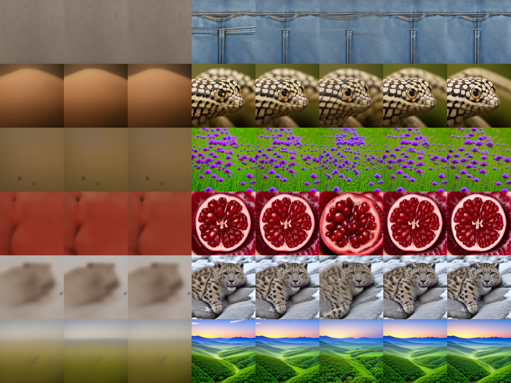

# Anatomy of Acceleration Adapters

Do different distillation methods change a diffusion model in the same direction? Few-step
distillation is often shipped as a low-rank weight delta on a base model, such as LCM-LoRA.
This repo takes those deltas apart in weight space, so that adapters from different methods
can be compared.

It is a term project for Generative Models for Multimedia at METU. The proposal is in
[`research_ideas/proposal.md`](research_ideas/proposal.md).

## Current direction

**Status: pilots done on one adapter; the cross-method comparison has not started.**

The pilots dissected LCM-LoRA for Stable Diffusion 1.5 (278 layers, rank 64) at 4 steps on
16 prompts. "Recovery" is how much of the full adapter's effect a part reproduces, measured
by LPIPS distance to the full adapter's same-seed image.

| Directions kept per layer | Share of adapter energy | Recovery | CLIP |
|---|---:|---:|---:|
| None (base model at 4 steps) | 0% | 0.00 | 0.218 |
| All 64 | 100% | 1.00 | 0.320 |
| Top 4 | 97% | 0.96 | 0.320 |
| **Top 1** | **94%** | **0.87** | **0.321** |
| Directions 5 to 64 | 3% | 0.01 | 0.215 |
| 4 random directions | 8% | 0.01 - 0.02 | 0.217 - 0.218 |
| Top 1, decoder only | 77% | 0.73 | 0.322 |

- **One direction per layer carries the adapter.** The other 63 together give the same
  blur as no adapter, and so do random directions.
- **The decoder carries most of it.** Up blocks hold 82% of the adapter's energy and alone
  recover 0.75; down blocks alone recover 0.01.
- **The time-conditioning path is nearly idle.** Removing it costs 6% of the effect.



*Columns: no adapter, 4 random directions, directions 5 to 64, top 1, top 2, top 4 in the
decoder only, top 4, full adapter.*

This is one adapter, 16 prompts, one seed and a closeness metric, not image quality. The
next step is to check whether the TCD and Hyper-SD adapters for the same model are also
near one direction per layer, then compare those directions across methods. A decision
point is set for 1 December 2026.

| Read | For |
|---|---|
| [`research_ideas/proposal.md`](research_ideas/proposal.md) | Questions, hypotheses, plan and timeline |
| [`research_ideas/plan-explained.md`](research_ideas/plan-explained.md) | The plan in plain language |
| [`docs/LITERATURE_REVIEW.md`](docs/LITERATURE_REVIEW.md) | Background and related work |
| [`research_ideas/study-guide.md`](research_ideas/study-guide.md) | Reading list and reading order |
| [`research_ideas/pilots.md`](research_ideas/pilots.md) | How the pilots were run |

## Reproduce

Tested on an Apple M4 Pro with 24 GB, on MPS at batch size 1.

```bash
python3.13 -m venv .venv && .venv/bin/pip install -e '.[dev]'
.venv/bin/pytest

.venv/bin/python scripts/pilots/c_lora_anatomy.py     # location: blocks and layer types
.venv/bin/python scripts/pilots/c2_lora_controls.py   # rank, tail and random controls
```

The scripts need Stable Diffusion 1.5 and download the 135 MB LCM-LoRA file on first use.
They write `results/pilots/c_lora_anatomy.*` and `results/pilots/c2_lora_controls.*`; the
image above is from the second.

## Layout

```
research_ideas/              Proposal, plain-language plan, study guide and pilot notes
scripts/pilots/              Pilot experiments, including the adapter dissection
results/pilots/              Raw pilot outputs
src/wspd/metrics.py          LPIPS, CLIP and spectral metrics
src/wspd/lab.py              Sampler-level interventions used by the other pilots
docs/LITERATURE_REVIEW.md    Background and related work for the current direction
docs/EXPERIMENT_1.md         The project's earlier experiment, kept as a record
runs/                        Caches and generated images (gitignored)
```

## Earlier work

The repo began with a different experiment, on LLM-driven weight editing. Its write-up,
code and results are kept in [`docs/EXPERIMENT_1.md`](docs/EXPERIMENT_1.md).
