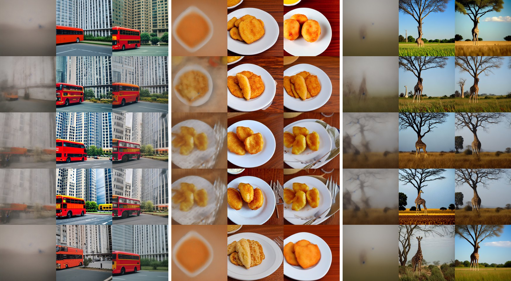

# Anatomy of Acceleration Adapters

What do different distillation methods change inside a diffusion model, and is it the same
thing? Few-step distillation is often shipped as a low-rank weight change on a base model,
such as LCM-LoRA. This repo takes those changes apart in weight space and compares them
across methods.

It is a term project for Generative Models for Multimedia at METU. The proposal is in
[`research_ideas/proposal.md`](research_ideas/proposal.md) and the results so far are in
[`docs/RESULTS.md`](docs/RESULTS.md).

## Current direction

**Status: first study done on Stable Diffusion 1.5; weight comparison repeated on SDXL,
SD3 Medium and FLUX.1-dev and against fully fine-tuned models; quality metrics, a
transfer test and a training pilot are at 500 and 100 COCO captions.**

The study compares nine public acceleration adapters from five independent methods (LCM,
TCD, PCM, Hyper-SD, Flash Diffusion), with three style adapters as controls. It uses 4
steps, 16 prompts and one seed.

- **Each adapter is close to one direction per layer.** The strongest of 64 directions
  holds 93% to 98% of the energy and keeps the full adapter's prompt alignment.
- **Independent methods partly agree on that direction.** Cosine 0.29 to 0.76 between
  methods, against 0.02 for random directions and 0.02 to 0.07 for style adapters.
- **The direction acts almost like a constant.** One fixed vector added to each layer's
  output, the same for every prompt and step, keeps prompt alignment within 0.003 of the
  full adapter in four of five methods.

- **The agreement holds on other base models.** 0.14 to 0.68 on SDXL (8 methods), 0.15 to
  0.30 on SD3 Medium, 0.20 to 0.49 on FLUX.1-dev; controls at or below 0.10.
- **Rank 1 belongs to the LoRA, the direction does not.** Fully fine-tuned few-step models
  are not rank 1, but their top direction agrees with the adapters' at 0.12 to 0.38.
- **The constant also works on SDXL.** For LCM, TCD, Hyper-SD and DMD2 (100 COCO captions,
  1024 px), one fixed vector per layer stays within 0.15 PickScore points of the full
  adapter; removing the adapter costs 3.5 to 4.9.
- **A strength per layer can be trained (pilot).** Frozen base model, shared direction
  fixed, 1,112 trained numbers: PickScore 18.77 to 20.90 at 4 steps (public adapters 21.3
  to 21.9; random direction 19.76).
- **An adapter built from the other methods works.** Direction and strength from the other
  four methods, one scale factor chosen on separate prompts: on 100 COCO captions it is
  within 0.1 PickScore points of the host's own adapter, or above it, for LCM-LoRA, TCD and
  Flash Diffusion, and keeps about 70% of the gain for PCM and Hyper-SD.
- **The direction can be read from the base model.** The gradient of a plain
  teacher-matching loss at the base weights agrees with the shared direction at 0.44
  (random 0.03, style adapters 0.04 to 0.06). Strengths trained on it reach PickScore
  20.75, with no existing adapter used. The gradient of LCM's own consistency loss points
  the same way (0.67 with the plain loss's gradient).


*SDXL at 4 steps. Rows: LCM, TCD, Hyper-SD, DMD2. In each group of four: no adapter, full
adapter, top direction only, one constant per layer.*



*SD 1.5 at 4 steps. Rows: LCM, TCD, PCM, Hyper-SD, Flash as host. In each group of three:
no adapter, the host's full adapter, an adapter built only from the other four methods.*

| Adapter | Energy in top direction | CLIP: no adapter | Top direction only | One constant per layer | Full adapter |
|---|---:|---:|---:|---:|---:|
| LCM-LoRA | 94% | 0.218 | 0.321 | 0.317 | 0.320 |
| TCD | 98% | 0.260 | 0.328 | 0.330 | 0.330 |
| PCM | 97% | 0.272 | 0.325 | 0.325 | 0.322 |
| Hyper-SD 4-step | 96% | 0.272 | 0.316 | 0.319 | 0.322 |
| Flash Diffusion | 93% | 0.218 | 0.337 | 0.313 | 0.335 |


*TCD adapter at 4 steps. Columns: no adapter, one constant per layer, one constant per
layer and step, coefficient averaged over positions, top direction only, full adapter.*

The table above is prompt alignment on 16 prompts. On 500 COCO captions (section 7 of the
results) one constant per layer costs 0.01 to 0.15 PickScore points on four of five
methods, against 2.8 to 3.4 for removing the adapter, with FID not worse. The
next steps are FID at 5,000 captions, function tests on SD3 and FLUX, and the gradient
direction under other losses. A decision point is set for 6 December 2026.

| Read | For |
|---|---|
| [`research_ideas/proposal.md`](research_ideas/proposal.md) | Questions, hypotheses, plan, order of work and timeline |
| [`docs/RESULTS.md`](docs/RESULTS.md) | Every result so far, with tables, images and limits |
| [`research_ideas/plan-explained.md`](research_ideas/plan-explained.md) | The plan in plain language |
| [`docs/LITERATURE_REVIEW.md`](docs/LITERATURE_REVIEW.md) | Background and related work |
| [`research_ideas/study-guide.md`](research_ideas/study-guide.md) | Reading list and reading order |

## Reproduce

Tested on an Apple M4 Pro with 24 GB, on MPS at batch size 1.

```bash
python3.13 -m venv .venv && .venv/bin/pip install -e '.[dev]'
.venv/bin/pytest

.venv/bin/python scripts/study/s1_weights.py     # weight comparison; no image generation
.venv/bin/python scripts/study/s2_function.py    # rank-1 and swap tests
.venv/bin/python scripts/study/s3_mechanism.py   # constant-shift and guidance tests
```

The scripts need Stable Diffusion 1.5 and download about 2 GB of adapters on first use.
The full list of scripts and their run time is at the end of
[`docs/RESULTS.md`](docs/RESULTS.md).

## Layout

```
research_ideas/              Proposal, plain-language plan and study guide
docs/RESULTS.md              Results of the first study
docs/LITERATURE_REVIEW.md    Background and related work
scripts/study/               The cross-method study (adapters.py holds the adapter list)
results/study/               Its outputs: JSON tables and image sheets
scripts/pilots/              Earlier pilots, including the first LCM-LoRA dissection
results/pilots/              Their outputs
src/wspd/metrics.py          LPIPS, CLIP and spectral metrics
docs/EXPERIMENT_1.md         The project's earlier experiment, kept as a record
runs/                        Caches and generated images (gitignored)
```

## Earlier work

The repo began with a different experiment, on LLM-driven weight editing. Its write-up,
code and results are kept in [`docs/EXPERIMENT_1.md`](docs/EXPERIMENT_1.md).
