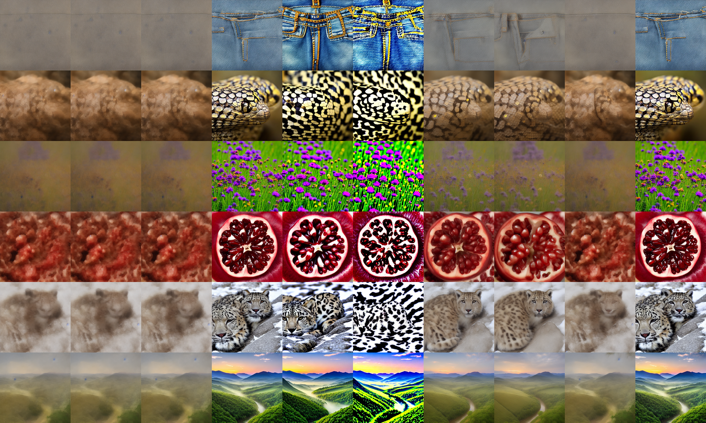
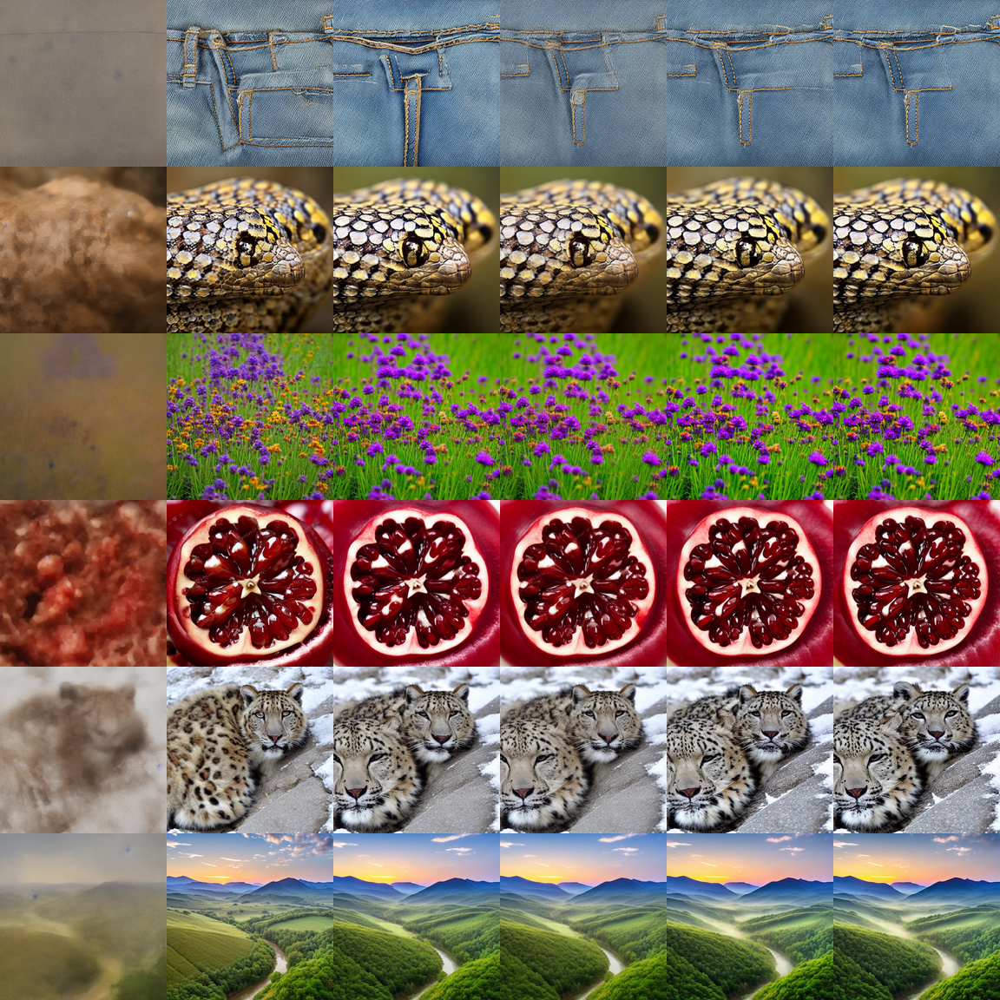

# Study results: what acceleration adapters have in common

First study for the [project proposal](../research_ideas/proposal.md), run on 15 and 16
November 2026 on one laptop (Apple M4 Pro, 24 GB). It compares nine public few-step
adapters for Stable Diffusion 1.5 in weight space and in function.

## Findings

1. **Every acceleration adapter is close to one direction per layer.** The strongest of
   64 directions holds 93% to 98% of each adapter's energy. Keeping only that one keeps
   the full adapter's prompt alignment in all five methods tested.
2. **Independent methods partly agree on the direction.** The cosine between two
   methods' top output directions is 0.29 to 0.76. Random directions give 0.02 to 0.03.
3. **The agreement is specific to acceleration.** Style adapters agree with the
   acceleration adapters at 0.02 to 0.07, and with each other at 0.02 to 0.03.
4. **The agreement is not inherited.** Adapters from different methods did not start from
   the same point.
5. **A borrowed direction works once re-scaled.** The direction that the other methods
   agree on, with one global scale factor, gives the host adapter's prompt alignment on
   three of four hosts.
6. **The direction acts almost like a constant.** One fixed vector added to each layer's
   output, the same for every prompt, position and step, keeps prompt alignment within
   0.003 of the full adapter on four of five methods.
7. **It is partly built-in guidance.** The adapters' effect on the network output lines
   up with the guidance direction at the first step and less at later steps.

## How far to trust this

- **Small sample.** 16 prompts and one seed per prompt. No intervals are reported here.
- **No quality metric.** "Recovery" measures closeness to the full adapter's image, and
  CLIP score measures prompt alignment. Neither measures image quality. The base model
  with guidance at 4 steps scores 0.321 on CLIP, as high as the adapters, so CLIP alone
  cannot rank these arms.
- **One base model.** Stable Diffusion 1.5 only.
- **Scale factors were chosen on the test prompts.** Finding 5 picks the best of 7 or 8
  factors on the same 16 prompts, which flatters it.
- **Shared training data is not ruled out.** The methods are independent in starting
  point, but all were trained from the same base model, possibly on overlapping images.
- **The baseline has no guidance.** "None" is the base model at 4 steps without
  guidance, so an adapter's measured effect mixes step-skipping and built-in guidance.

## Setup

| Adapter | Source | Method family | Layers | Rank | Sampler used |
|---|---|---|---:|---:|---|
| LCM-LoRA | `latent-consistency/lcm-lora-sdv1-5` | Consistency | 278 | 64 | LCM |
| TCD | `h1t/TCD-SD15-LoRA` | Trajectory consistency | 278 | 64 | TCD |
| PCM (4-step) | `wangfuyun/PCM_Weights` | Phased consistency, adversarial | 278 | 64 | DDIM, trailing |
| PCM (LCM-like) | `wangfuyun/PCM_Weights` | Phased consistency, adversarial | 278 | 64 | weights only |
| Hyper-SD 1, 2, 4, 8-step | `ByteDance/Hyper-SD` | Segmented consistency, adversarial, preference | 278 | 64 | DDIM, trailing (4-step) |
| Flash Diffusion | `jasperai/flash-sd` | Distribution matching, adversarial | 128 | 128 | LCM |
| Style: Monet A | `neonforestmist/sd15-monet-lora` | Style (control) | 192 | 32 | weights only |
| Style: Monet B | `J-YOON/lora-monet-sd1.5` | Style (control) | 192 | 8 | weights only |
| Style: pixel art | `artificialguybr/pixelartredmond-1-5v-pixel-art-loras-for-sd-1-5` | Style (control) | 192 | 32 | weights only |

Flash Diffusion and the style adapters change attention layers only, so comparisons with
them cover those layers. Exact file names and revisions are in
`scripts/study/adapters.py`.

**Sampling.** 4 steps, no guidance, 16 prompts from the development split, one seed.

**Measures.**

- **Recovery:** 1 minus the LPIPS distance to the full adapter's same-seed image, divided
  by the distance of the base model with no adapter. 1 means identical to the full
  adapter, 0 means no better than no adapter.
- **CLIP:** similarity between the image and its prompt.
- **Agreement:** absolute cosine between two adapters' top output directions in a layer,
  averaged over shared layers and weighted by energy.

## 1. Each adapter is one direction per layer

| Adapter | Energy in top direction | Energy in decoder | Energy in time layers | Size of change |
|---|---:|---:|---:|---:|
| LCM-LoRA | 94% | 82% | 1% | 1.8 |
| TCD | 98% | 89% | 1% | 2.7 |
| PCM (4-step) | 97% | 94% | 19% | 5.6 |
| PCM (LCM-like) | 98% | 93% | 1% | 5.9 |
| Hyper-SD 1-step | 96% | 87% | 2% | 9.0 |
| Hyper-SD 2-step | 96% | 82% | 2% | 7.2 |
| Hyper-SD 4-step | 96% | 81% | 2% | 6.8 |
| Hyper-SD 8-step | 95% | 80% | 2% | 6.5 |
| Flash Diffusion | 93% | 93% | none | 7.1 |
| Style adapters (3) | 90% to 95% | 62% to 65% | none | 14 to 47 |

"Size of change" is the Frobenius norm of the whole adapter.

Function, per method, with its own sampler:

| Host adapter | CLIP: no adapter | Top direction only | All but the top direction | Random direction | Full adapter |
|---|---:|---|---|---|---:|
| LCM-LoRA | 0.218 | 0.87 / 0.321 | 0.01 / 0.217 | 0.00 / 0.219 | 0.320 |
| TCD | 0.260 | 0.93 / 0.328 | 0.03 / 0.263 | 0.00 / 0.260 | 0.330 |
| PCM | 0.272 | 0.83 / 0.325 | 0.11 / 0.286 | 0.01 / 0.272 | 0.322 |
| Hyper-SD 4-step | 0.272 | 0.62 / 0.316 | 0.10 / 0.292 | 0.00 / 0.273 | 0.322 |
| Flash Diffusion | 0.218 | 0.79 / 0.337 | 0.01 / 0.219 | 0.00 / 0.219 | 0.335 |

Cells with two numbers are recovery / CLIP.

- **The decoder holds most of the energy in every adapter,** 80% to 94%. The ablation
  below has been run only on LCM-LoRA.
- **PCM is the exception on time layers,** with 19% of its energy there.
- **Hyper-SD is the weakest case for rank 1.** Its top direction keeps prompt alignment
  but only 0.62 of the image.
- **Style adapters are also concentrated,** so concentration alone does not mark an
  adapter as an acceleration adapter. Agreement does.

For reference, the base model scores 0.336 on CLIP at 50 steps with guidance and 0.321 at
4 steps with guidance.

**Location, LCM-LoRA only** (pilot of 10 November). Recovery when one part is kept alone
and when it is removed:

| Part kept alone | Recovery | | Layer type | Energy share | Kept alone | Removed |
|---|---:|---|---|---:|---:|---:|
| Decoder (up) blocks | 0.75 | | ResNet convolutions | 40% | 0.15 | 0.39 |
| Encoder (down) blocks | 0.01 | | Feed-forward | 38% | 0.04 | 0.59 |
| Middle block | 0.00 | | Attention projections | 7% | 0.04 | 0.76 |
| | | | Self-attention | 7% | 0.02 | 0.82 |
| | | | Cross-attention | 6% | 0.02 | 0.75 |
| | | | Time-embedding projections | 1% | 0.00 | 0.94 |

No single layer type is enough alone; the decoder alone is most of it.

## 2. Independent methods agree on the direction


| Pairs compared | Output-side agreement | Input-side agreement | Cosine of whole changes |
|---|---:|---:|---:|
| Two independent acceleration methods (10 pairs) | 0.29 to 0.76 | 0.33 to 0.69 | +0.13 to +0.48 |
| Hyper-SD at different step counts (6 pairs) | 0.85 to 0.99 | 0.93 to 1.00 | +0.80 to +0.99 |
| Acceleration against style (15 pairs) | 0.02 to 0.07 | 0.09 to 0.30 | -0.00 to +0.01 |
| Style against style (3 pairs) | 0.02 to 0.03 | 0.14 to 0.43 | -0.00 to +0.01 |
| Random directions | 0.02 to 0.03 | | 0 |
| Same pair, layers of equal shape mismatched | 0.02 to 0.04 | | |

The independent methods are LCM-LoRA, TCD, PCM, Hyper-SD 4-step and Flash Diffusion.

- **The closest pair is LCM-LoRA and TCD** (0.76), both consistency methods. **The
  furthest is Hyper-SD and Flash Diffusion** (0.29). Agreement falls as the training
  objectives differ more, and stays more than ten times the random value.
- **The sign agrees too.** In 90% to 100% of layers, two acceleration adapters push in
  the same direction and not the opposite one. For pairs involving a style adapter it is
  38% to 64%, around chance.
- **Agreement is even across the network.** For LCM-LoRA and TCD it is 0.72 to 0.78 in
  every block group and 0.72 to 0.86 in every layer type.
- **The input side is partly generic.** Style adapters agree with everything at 0.09 to
  0.43 on the input side. All adapters seem to read from similar input directions; only
  acceleration adapters write to similar output directions.
- **Two Monet adapters do not agree** (0.03), although they learned the same style.

### Not inherited from a shared starting point

LoRA training starts from a random input-side matrix, and training barely moves the weak
directions. If two adapters shared a starting matrix, their weak input directions would
span the same subspace.

| Pairs | Overlap of weak input subspaces | Value for unrelated subspaces |
|---|---:|---:|
| Different methods (all 29 pairs) | 0.069 (0.198 with Flash) | 0.069 (0.197 with Flash) |
| Hyper-SD step counts | 0.98 to 1.00 | 0.069 |
| PCM versions | 0.96 | 0.069 |

Different methods match the unrelated value to three decimals. The Hyper-SD family and
the two PCM adapters do share a starting point, so they are same-method references, not
independent evidence.

### New directions, not the base model's own

The top directions lie mostly outside the base weight's dominant directions. Their share
in the strongest tenth of the base weight's singular directions is 0.14 to 0.19 on the
output side, where an unrelated direction would give 0.10. Their largest cosine with any
single base direction is 0.15 to 0.18. They are "intruder" directions in the sense of
Shuttleworth et al., and they still agree across methods.

## 3. Borrowed directions work once re-scaled

**Swap at the host's strength.** Each host's top direction is replaced, layer by layer,
with another method's. "Consensus" is the direction the other four methods agree on.
Cells are recovery / CLIP.

| Host | No adapter | From LCM | From TCD | From PCM | From Hyper-SD | From Flash | Consensus | Own |
|---|---:|---|---|---|---|---|---|---|
| LCM-LoRA | 0.218 | | 0.37 / 0.292 | 0.11 / 0.257 | 0.09 / 0.249 | 0.01 / 0.220 | 0.35 / 0.296 | 0.87 / 0.321 |
| TCD | 0.260 | 0.40 / 0.299 | | 0.37 / 0.324 | 0.31 / 0.319 | 0.09 / 0.274 | 0.60 / 0.326 | 0.93 / 0.328 |
| PCM | 0.272 | 0.17 / 0.263 | 0.31 / 0.286 | | 0.47 / 0.310 | 0.19 / 0.306 | 0.27 / 0.279 | 0.83 / 0.325 |
| Hyper-SD 4-step | 0.272 | 0.18 / 0.261 | 0.34 / 0.304 | 0.42 / 0.323 | | 0.14 / 0.306 | 0.30 / 0.296 | 0.62 / 0.316 |
| Flash Diffusion | 0.218 | 0.15 / 0.238 | 0.16 / 0.279 | 0.17 / 0.288 | 0.10 / 0.245 | | 0.14 / 0.266 | 0.79 / 0.337 |

A straight swap transfers only part of the effect. The images show why: they move the
right way, toward sharp and on-prompt, but by the wrong amount, over-contrasted or soft.



*TCD as host. Columns: no adapter, random direction, all but the top direction, top
direction, consensus of the other methods, direction from LCM, from PCM, from Hyper-SD,
from Flash, full adapter.*

**With one global scale factor.** The consensus direction is installed at the host's
per-layer strength times one number.

| Host | Full adapter CLIP | Best CLIP with consensus | At factor | Best recovery | At factor |
|---|---:|---:|---:|---:|---:|
| LCM-LoRA | 0.320 | 0.309 | 1.4 | 0.51 | 1.4 |
| TCD | 0.330 | 0.330 | 0.5 | 0.71 | 0.85 |
| PCM | 0.322 | 0.329 | 0.25 | 0.51 | 0.25 |
| Hyper-SD 4-step | 0.322 | 0.333 | 0.25 | 0.52 | 0.35 |

A random direction gives no recovery at any factor tried. So a direction built only from
*other* methods, plus one number, restores prompt alignment on three of four hosts and
comes within 0.011 on LCM-LoRA. Recovery of 0.5 to 0.7 means the images are sharp and
on-prompt but not the host's images. The factor was chosen on the same 16 prompts.

## 4. What the direction does

### Nearly a constant per layer

A rank-1 change adds `s · u · (v · x)` to a layer's output. If the coefficient `v · x`
hardly varies, this is a constant vector. Its per-step mean explains 72% to 90% of its
mean square (87% to 90% for the four adapters that change every layer type).

The coefficient was then replaced, in steps, by something simpler. Constants were
estimated on 8 prompts. Cells are recovery / CLIP on all 16 prompts.

| Host | Top direction (rank 1) | Coefficient averaged over positions | One constant per layer and step | One constant per layer | Full adapter CLIP |
|---|---|---|---|---|---:|
| LCM-LoRA | 0.87 / 0.321 | 0.71 / 0.312 | 0.67 / 0.310 | 0.57 / 0.317 | 0.320 |
| TCD | 0.93 / 0.328 | 0.85 / 0.323 | 0.86 / 0.320 | 0.63 / 0.330 | 0.330 |
| PCM | 0.83 / 0.325 | 0.77 / 0.323 | 0.78 / 0.325 | 0.53 / 0.325 | 0.322 |
| Hyper-SD 4-step | 0.62 / 0.316 | 0.54 / 0.313 | 0.55 / 0.308 | 0.47 / 0.319 | 0.322 |
| Flash Diffusion | 0.79 / 0.337 | 0.27 / 0.283 | 0.58 / 0.317 | 0.57 / 0.313 | 0.335 |



*TCD as host. Columns: no adapter, one constant per layer, one constant per layer and
step, coefficient averaged over positions, top direction, full adapter.*

- **A fixed vector per layer gives sharp, on-prompt images.** It ignores the prompt, the
  position in the image and the step. Prompt alignment is within 0.003 of the full
  adapter for four methods and 0.022 lower for Flash Diffusion.
- **It generalises across prompts.** On the 8 prompts not used to estimate the
  constants, recovery is within 0.02 of the value on all 16.
- **The step matters for closeness.** One constant per layer and step recovers 0.55 to
  0.86 of the full adapter's image; a single constant recovers 0.47 to 0.63.
- **One odd result.** For Flash Diffusion, averaging the coefficient over positions does
  worse than a constant. Not yet explained.

This is not yet a way to get few-step sampling without distillation: the vectors and
constants were read out of trained adapters.

### Partly built-in guidance

On each adapter's own sampling path, the change it makes to the network output was
compared with the base model's guidance direction (prompted minus unprompted output).

| Host | Cosine with guidance, steps 1 to 4 | Same, with another prompt's guidance (step 1) | Share explained by guidance and rescaling, steps 1 to 4 |
|---|---|---:|---|
| LCM-LoRA | 0.43, 0.24, 0.22, 0.13 | 0.05 | 0.47, 0.37, 0.38, 0.33 |
| TCD | 0.50, 0.26, 0.11, 0.12 | 0.08 | 0.42, 0.29, 0.29, 0.34 |
| PCM | 0.61, 0.39, 0.20, 0.11 | 0.12 | 0.40, 0.20, 0.19, 0.47 |
| Hyper-SD 4-step | 0.45, 0.16, 0.18, 0.18 | 0.07 | 0.25, 0.08, 0.09, 0.16 |
| Flash Diffusion | 0.20, 0.17, 0.12, 0.10 | 0.05 | 0.61, 0.60, 0.54, 0.47 |

- **At the first step the adapters act like guidance for the right prompt.** Cosines of
  0.20 to 0.61, against 0.05 to 0.12 for another prompt's guidance.
- **Later steps are something else.** The cosine falls to 0.10 to 0.18 by the last step.
- **Guidance plus a rescaling of the prediction explains under half** of the effect for
  the four adapters that change every layer type, and about half for Flash Diffusion.

## What this means for the proposal

| Earlier hypothesis (second version) | Result at this scale |
|---|---|
| Other adapters are also near rank 1 | Held for all five methods on prompt alignment |
| Output directions agree across methods | Held: 0.29 to 0.76 against 0.02 to 0.07 for controls |
| The agreement is functional | Partly: a swap needs a scale factor |
| Location agrees across adapters | Held on energy (decoder 80% to 94%); ablation not repeated |
| A shared direction is usable | Held on prompt alignment for three of four hosts, with one scale |

New at this stage, and not in any earlier version: the constant-per-layer result and the
guidance comparison. The third version of the proposal is built around them.

## Reproduce

```bash
.venv/bin/python scripts/study/s1_weights.py         # sections 1 and 2; no image generation
.venv/bin/python scripts/study/fig_agreement.py      # the agreement figure
.venv/bin/python scripts/study/s5_lineage.py         # starting-point check
.venv/bin/python scripts/study/s4_base_alignment.py  # relation to the base weights
.venv/bin/python scripts/study/s2_function.py        # section 1 function table and swaps
.venv/bin/python scripts/study/s6_strength.py        # scale factors
.venv/bin/python scripts/study/s3_mechanism.py       # section 4
```

The first run downloads about 2 GB of adapters from Hugging Face. The image-generating
scripts take about two hours in total on the laptop above. Outputs are in
`results/study/`.
