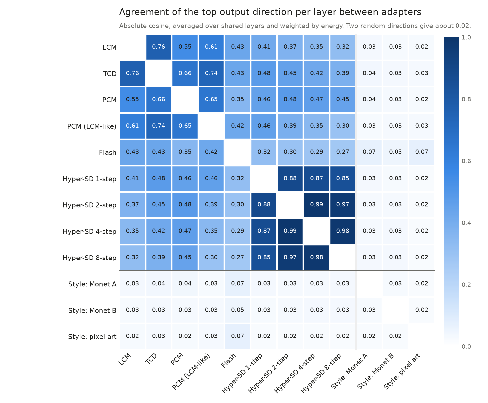
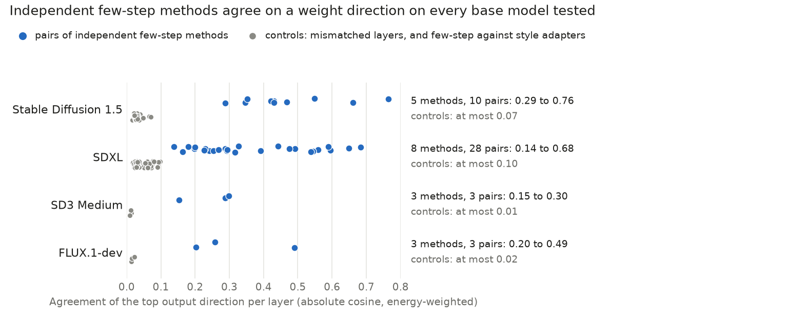
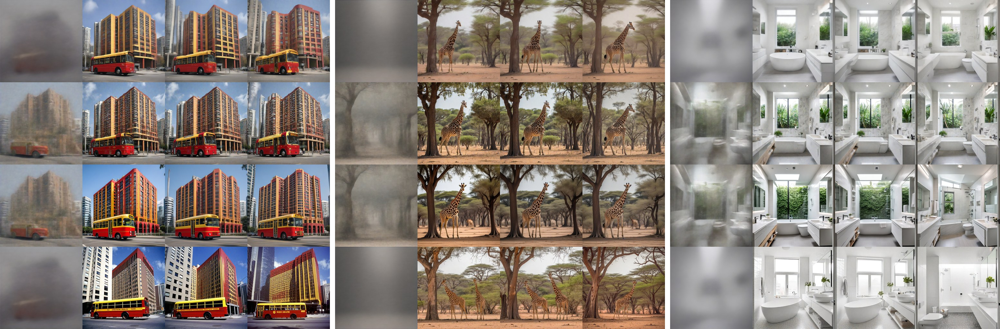
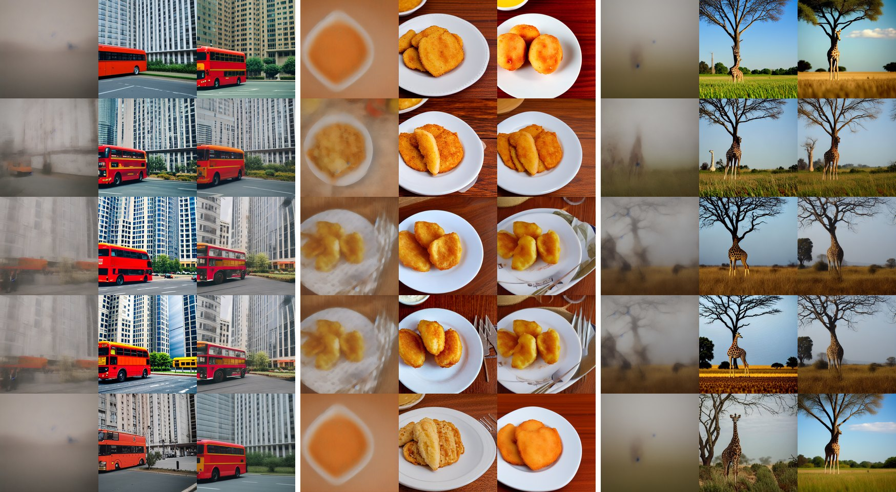

# Study results: what acceleration adapters have in common

First study for the [project proposal](../research_ideas/proposal.md), run on 15 and 16
November 2026 on one laptop (Apple M4 Pro, 24 GB). It compares nine public few-step
adapters for Stable Diffusion 1.5 in weight space and in function. Sections 5 to 13
were added from 19 to 21 November: other base models, fully fine-tuned models,
image-quality metrics on COCO captions, a small training pilot, the function test on SDXL,
an ablation by block and layer type, a transfer test on held-out captions and the direction
read from two loss gradients.

## Findings

1. **Every acceleration adapter is close to one direction per layer.** The strongest of
   64 directions holds 93% to 98% of each adapter's energy. Keeping only that one keeps
   the full adapter's prompt alignment in all five methods tested.
2. **Independent methods partly agree on the direction.** The cosine between two
   methods' top output directions is 0.29 to 0.76. Random directions give 0.02 to 0.03.
3. **The agreement is specific to acceleration.** Style adapters agree with the
   acceleration adapters at 0.02 to 0.07, and with each other at 0.02 to 0.03.
4. **The agreement is not inherited.** Adapters from different methods did not start from
   the same point.
5. **A borrowed direction works once re-scaled.** The direction that the other methods
   agree on, with one global scale factor, gives the host adapter's prompt alignment on
   three of four hosts.
6. **The direction acts almost like a constant.** One fixed vector added to each layer's
   output, the same for every prompt, position and step, keeps prompt alignment within
   0.003 of the full adapter on four of five methods.
7. **It is partly built-in guidance.** The adapters' effect on the network output lines
   up with the guidance direction at the first step and less at later steps.

8. **The agreement holds on three other base models.** Independent methods agree at
   0.14 to 0.68 on SDXL (8 methods), 0.15 to 0.30 on SD3 Medium and 0.20 to 0.49 on
   FLUX.1-dev. Controls stay at or below 0.10, 0.013 and 0.023.
9. **Rank 1 is a property of the LoRA, the direction is not.** Fully fine-tuned few-step
   models spread their change over many directions (top direction 4% to 14% of the
   energy), yet their top direction agrees with the adapters' at 0.12 to 0.38, against
   0.02 to 0.04 for style adapters.
10. **Quality metrics agree with the earlier picture (500 COCO captions).** On four of
    five methods, rank 1 costs at most 0.05 PickScore points and one constant per layer at
    most 0.15, against 2.8 to 3.4 points for removing the adapter; FID and CMMD do not get
    worse. Flash Diffusion loses 0.7 points with constants.
11. **A strength per layer can be trained from scratch (pilot).** With the base model
    frozen and the shared direction fixed, 1,112 trained numbers move PickScore from 18.77
    to 20.90 in 4 steps. A random direction with the same budget reaches 19.76, and a free
    bias with 1.26 million numbers reaches 20.51.

12. **Rank 1 and the constant also work on SDXL.** For LCM, TCD, Hyper-SD and DMD2 on 100
    captions, one fixed vector per layer stays within 0.15 PickScore points of the full
    adapter, against 3.5 to 4.9 for removing it.

13. **The acceleration sits in the up blocks.** Removing them loses 81% to 98% of the
    adapter's PickScore gain in all four methods tested; keeping only them loses at most
    0.32 points. Convolutions matter most among layer types.

14. **An adapter built from the other methods works on held-out captions.** Direction and
    strength come from the other four methods, with one scale factor chosen on separate
    prompts. On 100 COCO captions it is within 0.1 PickScore points of the host's own
    adapter, or above it, for LCM-LoRA, TCD and Flash Diffusion, and keeps about 70% of the
    gain for PCM and Hyper-SD. A random direction at the same strength does nothing.

15. **A plain few-step loss points along the shared direction.** At the base weights, the
    gradient of a simple teacher-matching loss agrees with the direction the five methods
    share at 0.44, against 0.03 for random directions and 0.04 to 0.06 for style adapters.
    With strengths trained on this gradient direction PickScore reaches 20.75, against
    20.90 on the adapters' direction, so the recipe of finding 11 needs no existing adapter.
    The gradient of LCM's own consistency loss points the same way (0.67 with the plain
    loss's gradient, 0.40 with the shared direction).

## How far to trust this

- **Small sample.** 16 prompts and one seed per prompt. No intervals are reported here.
- **Quality metrics are at 500 captions.** Sections 1 to 4 use recovery and CLIP only.
  Section 7 adds PickScore, CMMD, FID and KID on 500 COCO captions, one seed each. FID at
  500 images is not comparable with published 5,000 or 30,000-image numbers.
- **Function was tested on two base models.** SD 1.5 (500 captions) and SDXL (100
  captions, section 9). SD3 and FLUX are compared in weights only.
- **The training pilot is small.** 200 training captions, 2 epochs, one seed, learning
  rates not tuned, 100 evaluation captions.
- **The gradient direction was taken for two losses:** a plain teacher-matching loss
  (section 12) and LCM's consistency loss (section 13). The adversarial and
  distribution-matching losses of the other methods are not tested.
- **Scale factors were chosen on the test prompts.** Finding 5 picks the best of 7 or 8
  factors on the same 16 prompts, which flatters it. Section 11 repeats the test with the
  factor chosen on the development prompts and the score taken on COCO captions.
- **Shared training data is not ruled out.** The methods are independent in starting
  point, but all were trained from the same base model, possibly on overlapping images.
- **The baseline has no guidance.** "None" is the base model at 4 steps without
  guidance, so an adapter's measured effect mixes step-skipping and built-in guidance.

## Setup

| Adapter | Source | Method family | Layers | Rank | Sampler used |
|---|---|---|---:|---:|---|
| LCM-LoRA | `latent-consistency/lcm-lora-sdv1-5` | Consistency | 278 | 64 | LCM |
| TCD | `h1t/TCD-SD15-LoRA` | Trajectory consistency | 278 | 64 | TCD |
| PCM (4-step) | `wangfuyun/PCM_Weights` | Phased consistency, adversarial | 278 | 64 | DDIM, trailing |
| PCM (LCM-like) | `wangfuyun/PCM_Weights` | Phased consistency, adversarial | 278 | 64 | weights only |
| Hyper-SD 1, 2, 4, 8-step | `ByteDance/Hyper-SD` | Segmented consistency, adversarial, preference | 278 | 64 | DDIM, trailing (4-step) |
| Flash Diffusion | `jasperai/flash-sd` | Distribution matching, adversarial | 128 | 128 | LCM |
| Style: Monet A | `neonforestmist/sd15-monet-lora` | Style (control) | 192 | 32 | weights only |
| Style: Monet B | `J-YOON/lora-monet-sd1.5` | Style (control) | 192 | 8 | weights only |
| Style: pixel art | `artificialguybr/pixelartredmond-1-5v-pixel-art-loras-for-sd-1-5` | Style (control) | 192 | 32 | weights only |

Flash Diffusion and the style adapters change attention layers only, so comparisons with
them cover those layers. Exact file names and revisions are in
`scripts/study/adapters.py`.

**Sampling.** 4 steps, no guidance, 16 prompts from the development split, one seed.

**Measures.**

- **Recovery:** 1 minus the LPIPS distance to the full adapter's same-seed image, divided
  by the distance of the base model with no adapter. 1 means identical to the full
  adapter, 0 means no better than no adapter.
- **CLIP:** similarity between the image and its prompt.
- **Agreement:** absolute cosine between two adapters' top output directions in a layer,
  averaged over shared layers and weighted by energy.

## 1. Each adapter is one direction per layer

| Adapter | Energy in top direction | Energy in decoder | Energy in time layers | Size of change |
|---|---:|---:|---:|---:|
| LCM-LoRA | 94% | 82% | 1% | 1.8 |
| TCD | 98% | 89% | 1% | 2.7 |
| PCM (4-step) | 97% | 94% | 19% | 5.6 |
| PCM (LCM-like) | 98% | 93% | 1% | 5.9 |
| Hyper-SD 1-step | 96% | 87% | 2% | 9.0 |
| Hyper-SD 2-step | 96% | 82% | 2% | 7.2 |
| Hyper-SD 4-step | 96% | 81% | 2% | 6.8 |
| Hyper-SD 8-step | 95% | 80% | 2% | 6.5 |
| Flash Diffusion | 93% | 93% | none | 7.1 |
| Style adapters (3) | 90% to 95% | 62% to 65% | none | 14 to 47 |

"Size of change" is the Frobenius norm of the whole adapter.

Function, per method, with its own sampler:

| Host adapter | CLIP: no adapter | Top direction only | All but the top direction | Random direction | Full adapter |
|---|---:|---|---|---|---:|
| LCM-LoRA | 0.218 | 0.87 / 0.321 | 0.01 / 0.217 | 0.00 / 0.219 | 0.320 |
| TCD | 0.260 | 0.93 / 0.328 | 0.03 / 0.263 | 0.00 / 0.260 | 0.330 |
| PCM | 0.272 | 0.83 / 0.325 | 0.11 / 0.286 | 0.01 / 0.272 | 0.322 |
| Hyper-SD 4-step | 0.272 | 0.62 / 0.316 | 0.10 / 0.292 | 0.00 / 0.273 | 0.322 |
| Flash Diffusion | 0.218 | 0.79 / 0.337 | 0.01 / 0.219 | 0.00 / 0.219 | 0.335 |

Cells with two numbers are recovery / CLIP.

- **The decoder holds most of the energy in every adapter,** 80% to 94%. The ablation
  below has been run only on LCM-LoRA.
- **PCM is the exception on time layers,** with 19% of its energy there.
- **Hyper-SD is the weakest case for rank 1.** Its top direction keeps prompt alignment
  but only 0.62 of the image.
- **Style adapters are also concentrated,** so concentration alone does not mark an
  adapter as an acceleration adapter. Agreement does.

For reference, the base model scores 0.336 on CLIP at 50 steps with guidance and 0.321 at
4 steps with guidance.

**Location, LCM-LoRA only** (pilot of 10 November). Recovery when one part is kept alone
and when it is removed:

| Part kept alone | Recovery | | Layer type | Energy share | Kept alone | Removed |
|---|---:|---|---|---:|---:|---:|
| Decoder (up) blocks | 0.75 | | ResNet convolutions | 40% | 0.15 | 0.39 |
| Encoder (down) blocks | 0.01 | | Feed-forward | 38% | 0.04 | 0.59 |
| Middle block | 0.00 | | Attention projections | 7% | 0.04 | 0.76 |
| | | | Self-attention | 7% | 0.02 | 0.82 |
| | | | Cross-attention | 6% | 0.02 | 0.75 |
| | | | Time-embedding projections | 1% | 0.00 | 0.94 |

No single layer type is enough alone; the decoder alone is most of it.

## 2. Independent methods agree on the direction



| Pairs compared | Output-side agreement | Input-side agreement | Cosine of whole changes |
|---|---:|---:|---:|
| Two independent acceleration methods (10 pairs) | 0.29 to 0.76 | 0.33 to 0.69 | +0.13 to +0.48 |
| Hyper-SD at different step counts (6 pairs) | 0.85 to 0.99 | 0.93 to 1.00 | +0.80 to +0.99 |
| Acceleration against style (15 pairs) | 0.02 to 0.07 | 0.09 to 0.30 | -0.00 to +0.01 |
| Style against style (3 pairs) | 0.02 to 0.03 | 0.14 to 0.43 | -0.00 to +0.01 |
| Random directions | 0.02 to 0.03 | | 0 |
| Same pair, layers of equal shape mismatched | 0.02 to 0.04 | | |

The independent methods are LCM-LoRA, TCD, PCM, Hyper-SD 4-step and Flash Diffusion.

- **The closest pair is LCM-LoRA and TCD** (0.76), both consistency methods. **The
  furthest is Hyper-SD and Flash Diffusion** (0.29). Agreement falls as the training
  objectives differ more, and stays more than ten times the random value.
- **The sign agrees too.** In 90% to 100% of layers, two acceleration adapters push in
  the same direction and not the opposite one. For pairs involving a style adapter it is
  38% to 64%, around chance.
- **Agreement is even across the network.** For LCM-LoRA and TCD it is 0.72 to 0.78 in
  every block group and 0.72 to 0.86 in every layer type.
- **The input side is partly generic.** Style adapters agree with everything at 0.09 to
  0.43 on the input side. All adapters seem to read from similar input directions; only
  acceleration adapters write to similar output directions.
- **Two Monet adapters do not agree** (0.03), although they learned the same style.

### Not inherited from a shared starting point

LoRA training starts from a random input-side matrix, and training barely moves the weak
directions. If two adapters shared a starting matrix, their weak input directions would
span the same subspace.

| Pairs | Overlap of weak input subspaces | Value for unrelated subspaces |
|---|---:|---:|
| Different methods (all 29 pairs) | 0.069 (0.198 with Flash) | 0.069 (0.197 with Flash) |
| Hyper-SD step counts | 0.98 to 1.00 | 0.069 |
| PCM versions | 0.96 | 0.069 |

Different methods match the unrelated value to three decimals. The Hyper-SD family and
the two PCM adapters do share a starting point, so they are same-method references, not
independent evidence.

### New directions, not the base model's own

The top directions lie mostly outside the base weight's dominant directions. Their share
in the strongest tenth of the base weight's singular directions is 0.14 to 0.19 on the
output side, where an unrelated direction would give 0.10. Their largest cosine with any
single base direction is 0.15 to 0.18. They are "intruder" directions in the sense of
Shuttleworth et al., and they still agree across methods.

## 3. Borrowed directions work once re-scaled

**Swap at the host's strength.** Each host's top direction is replaced, layer by layer,
with another method's. "Consensus" is the direction the other four methods agree on.
Cells are recovery / CLIP.

| Host | No adapter | From LCM | From TCD | From PCM | From Hyper-SD | From Flash | Consensus | Own |
|---|---:|---|---|---|---|---|---|---|
| LCM-LoRA | 0.218 | | 0.37 / 0.292 | 0.11 / 0.257 | 0.09 / 0.249 | 0.01 / 0.220 | 0.35 / 0.296 | 0.87 / 0.321 |
| TCD | 0.260 | 0.40 / 0.299 | | 0.37 / 0.324 | 0.31 / 0.319 | 0.09 / 0.274 | 0.60 / 0.326 | 0.93 / 0.328 |
| PCM | 0.272 | 0.17 / 0.263 | 0.31 / 0.286 | | 0.47 / 0.310 | 0.19 / 0.306 | 0.27 / 0.279 | 0.83 / 0.325 |
| Hyper-SD 4-step | 0.272 | 0.18 / 0.261 | 0.34 / 0.304 | 0.42 / 0.323 | | 0.14 / 0.306 | 0.30 / 0.296 | 0.62 / 0.316 |
| Flash Diffusion | 0.218 | 0.15 / 0.238 | 0.16 / 0.279 | 0.17 / 0.288 | 0.10 / 0.245 | | 0.14 / 0.266 | 0.79 / 0.337 |

A straight swap transfers only part of the effect. The images show why: they move the
right way, toward sharp and on-prompt, but by the wrong amount, over-contrasted or soft.


*TCD as host. Columns: no adapter, random direction, all but the top direction, top
direction, consensus of the other methods, direction from LCM, from PCM, from Hyper-SD,
from Flash, full adapter.*

**With one global scale factor.** The consensus direction is installed at the host's
per-layer strength times one number.

| Host | Full adapter CLIP | Best CLIP with consensus | At factor | Best recovery | At factor |
|---|---:|---:|---:|---:|---:|
| LCM-LoRA | 0.320 | 0.309 | 1.4 | 0.51 | 1.4 |
| TCD | 0.330 | 0.330 | 0.5 | 0.71 | 0.85 |
| PCM | 0.322 | 0.329 | 0.25 | 0.51 | 0.25 |
| Hyper-SD 4-step | 0.322 | 0.333 | 0.25 | 0.52 | 0.35 |

A random direction gives no recovery at any factor tried. So a direction built only from
*other* methods, plus one number, restores prompt alignment on three of four hosts and
comes within 0.011 on LCM-LoRA. Recovery of 0.5 to 0.7 means the images are sharp and
on-prompt but not the host's images. The factor was chosen on the same 16 prompts.

## 4. What the direction does

### Nearly a constant per layer

A rank-1 change adds `s · u · (v · x)` to a layer's output. If the coefficient `v · x`
hardly varies, this is a constant vector. Its per-step mean explains 72% to 90% of its
mean square (87% to 90% for the four adapters that change every layer type).

The coefficient was then replaced, in steps, by something simpler. Constants were
estimated on 8 prompts. Cells are recovery / CLIP on all 16 prompts.

| Host | Top direction (rank 1) | Coefficient averaged over positions | One constant per layer and step | One constant per layer | Full adapter CLIP |
|---|---|---|---|---|---:|
| LCM-LoRA | 0.87 / 0.321 | 0.71 / 0.312 | 0.67 / 0.310 | 0.57 / 0.317 | 0.320 |
| TCD | 0.93 / 0.328 | 0.85 / 0.323 | 0.86 / 0.320 | 0.63 / 0.330 | 0.330 |
| PCM | 0.83 / 0.325 | 0.77 / 0.323 | 0.78 / 0.325 | 0.53 / 0.325 | 0.322 |
| Hyper-SD 4-step | 0.62 / 0.316 | 0.54 / 0.313 | 0.55 / 0.308 | 0.47 / 0.319 | 0.322 |
| Flash Diffusion | 0.79 / 0.337 | 0.27 / 0.283 | 0.58 / 0.317 | 0.57 / 0.313 | 0.335 |


*TCD as host. Columns: no adapter, one constant per layer, one constant per layer and
step, coefficient averaged over positions, top direction, full adapter.*

- **A fixed vector per layer gives sharp, on-prompt images.** It ignores the prompt, the
  position in the image and the step. Prompt alignment is within 0.003 of the full
  adapter for four methods and 0.022 lower for Flash Diffusion.
- **It generalises across prompts.** On the 8 prompts not used to estimate the
  constants, recovery is within 0.02 of the value on all 16.
- **The step matters for closeness.** One constant per layer and step recovers 0.55 to
  0.86 of the full adapter's image; a single constant recovers 0.47 to 0.63.
- **One odd result.** For Flash Diffusion, averaging the coefficient over positions does
  worse than a constant. Not yet explained.

This is not yet a way to get few-step sampling without distillation: the vectors and
constants were read out of trained adapters.

### Partly built-in guidance

On each adapter's own sampling path, the change it makes to the network output was
compared with the base model's guidance direction (prompted minus unprompted output).

| Host | Cosine with guidance, steps 1 to 4 | Same, with another prompt's guidance (step 1) | Share explained by guidance and rescaling, steps 1 to 4 |
|---|---|---:|---|
| LCM-LoRA | 0.43, 0.24, 0.22, 0.13 | 0.05 | 0.47, 0.37, 0.38, 0.33 |
| TCD | 0.50, 0.26, 0.11, 0.12 | 0.08 | 0.42, 0.29, 0.29, 0.34 |
| PCM | 0.61, 0.39, 0.20, 0.11 | 0.12 | 0.40, 0.20, 0.19, 0.47 |
| Hyper-SD 4-step | 0.45, 0.16, 0.18, 0.18 | 0.07 | 0.25, 0.08, 0.09, 0.16 |
| Flash Diffusion | 0.20, 0.17, 0.12, 0.10 | 0.05 | 0.61, 0.60, 0.54, 0.47 |

- **At the first step the adapters act like guidance for the right prompt.** Cosines of
  0.20 to 0.61, against 0.05 to 0.12 for another prompt's guidance.
- **Later steps are something else.** The cosine falls to 0.10 to 0.18 by the last step.
- **Guidance plus a rescaling of the prediction explains under half** of the effect for
  the four adapters that change every layer type, and about half for Flash Diffusion.

## 5. Other base models

Weights only, no image generation. Same measures as sections 1 and 2. The transformer
adapters store no LoRA alpha and are read at scale 1, which leaves directions and energy
shares unchanged.



| Base model | Independent methods | Pairs | Agreement (range, mean) | Largest control |
|---|---|---:|---|---:|
| SD 1.5 | LCM, TCD, PCM, Hyper-SD, Flash | 10 | 0.29 to 0.76, 0.47 | 0.07 |
| SDXL | LCM, TCD, PCM, Hyper-SD, DMD2, Lightning, Flash, TDD | 28 | 0.14 to 0.68, 0.36 | 0.10 |
| SD3 Medium | Hyper-SD, PCM, Flash | 3 | 0.15 to 0.30, 0.25 | 0.013 |
| FLUX.1-dev | Hyper-SD, Turbo-Alpha, TDD | 3 | 0.20 to 0.49, 0.32 | 0.023 |

- **Controls.** SDXL: three style adapters (acceleration against style 0.02 to 0.10,
  style against style 0.03 to 0.05), random directions and mismatched layers of equal
  shape (0.01 to 0.05). SD3 and FLUX: random directions and mismatched layers only; no
  style adapters were included.
- **Concentration.** Top-direction energy is 0.90 to 0.98 for seven of eight SDXL methods
  (Flash 0.82), 0.84 to 0.99 on SD3, and 0.91 to 0.95 on FLUX except Turbo-Alpha at 0.37.
  SDXL style adapters: 0.82, 0.11 and 0.48.
- **Starting point.** For every independent pair the overlap of the weak input directions
  equals that of unrelated subspaces. Same-family pairs differ: Hyper-FLUX 8-step and
  16-step overlap at 0.97.
- **Same family.** Agreement is higher within a release family, for example Hyper-SDXL
  4-step against 8-step 0.995 and against 1-step 0.64, Lightning 4-step against 2-step
  0.83, TDD with and without the adversarial loss 0.89.
- **Highest and lowest SDXL pairs.** TCD and TDD 0.68; Lightning and Flash 0.14.

## 6. Fully fine-tuned few-step models

A LoRA can only make a low-rank change. Three fully fine-tuned SD 1.5-family students
were compared with their own base model on the 278 layers the adapters touch.

| Student | Method | Top-direction energy | Share of rank for 90% energy | Agreement with acceleration adapters | With style adapters |
|---|---|---:|---:|---|---|
| DMD2 (1 step) | distribution matching, adversarial | 0.071 | 0.22 | 0.16 to 0.38 | 0.02 to 0.04 |
| LCM DreamShaper v7 | consistency, DreamShaper 7 base | 0.137 | 0.19 | 0.16 to 0.34 | 0.02 to 0.04 |
| 2-Rectified Flow | reflow | 0.040 | 0.33 | 0.12 to 0.14 | 0.02 to 0.04 |

- **The full change is not rank 1.** Concentration in one direction comes from the LoRA
  form, or from what LoRA training keeps, not from few-step training as such.
- **The direction is still there.** The top direction of each full change agrees with
  the adapters' top direction well above the controls, although at most 0.7% of the full
  change's energy lies along it.
- **Students agree with each other less:** DMD2 and LCM 0.23, DMD2 and reflow 0.13,
  reflow and LCM 0.09.
- **Rectified flow is the weakest match**, which fits its different training target
  (straight paths, not consistency or distribution matching).

## 7. Image quality on COCO captions

500 captions from MS-COCO 2014 val, one seed each, 512 px, 4 steps without guidance.
PickScore is a learned human-preference score (higher is better). CMMD is the CLIP-MMD
distance to the real COCO photos, FID and KID (times 1000) are clean-fid against the same
photos (all lower is better). FID is biased upward at 500 images, so only differences
between rows mean anything. PickScore differences are against the same method's full
adapter, with paired bootstrap 95% intervals.

| Arm | CLIP | PickScore | CMMD | FID | KID |
|---|---:|---:|---:|---:|---:|
| Real COCO photos | 0.303 | 21.26 | | | |
| Base model, 25 steps, guidance 7.5 | 0.315 | 21.55 | 0.48 | 97.1 | 3.5 |
| Base model, 4 steps, guidance 7.5 | 0.308 | 20.43 | 0.87 | 110.4 | 8.5 |
| Base model, 4 steps, no adapter, DDIM | 0.249 | 18.71 | 2.39 | 190.2 | 73.5 |
| Base model, 4 steps, no adapter, LCM sampler | 0.204 | 17.85 | 3.59 | 260.6 | 145.2 |
| Base model, 4 steps, no adapter, TCD sampler | 0.236 | 18.28 | 2.83 | 208.1 | 85.2 |

| Method | Version | CLIP | PickScore | CMMD | FID | KID | PickScore minus full | Wins against full |
|---|---|---:|---:|---:|---:|---:|---|---:|
| LCM | full | 0.305 | 21.21 | 0.51 | 105.2 | 7.6 | | |
| | rank 1 | 0.305 | 21.19 | 0.51 | 105.6 | 7.6 | -0.02 [-0.05, +0.02] | 0.50 |
| | constant per layer and step | 0.301 | 21.01 | 0.50 | 105.8 | 7.7 | -0.20 [-0.26, -0.15] | 0.38 |
| | constant per layer | 0.302 | 21.06 | 0.44 | 102.0 | 4.8 | -0.15 [-0.22, -0.07] | 0.45 |
| TCD | full | 0.308 | 21.32 | 0.44 | 98.6 | 4.6 | | |
| | rank 1 | 0.308 | 21.30 | 0.44 | 99.4 | 5.0 | -0.02 [-0.05, +0.00] | 0.47 |
| | constant per layer and step | 0.306 | 21.21 | 0.42 | 99.7 | 5.3 | -0.11 [-0.15, -0.07] | 0.43 |
| | constant per layer | 0.304 | 21.28 | 0.39 | 98.1 | 2.7 | -0.04 [-0.10, +0.02] | 0.49 |
| PCM | full | 0.304 | 21.49 | 0.47 | 102.0 | 8.1 | | |
| | rank 1 | 0.306 | 21.52 | 0.46 | 99.9 | 6.6 | +0.03 [-0.01, +0.07] | 0.56 |
| | constant per layer and step | 0.303 | 21.40 | 0.46 | 100.2 | 6.9 | -0.09 [-0.13, -0.04] | 0.44 |
| | constant per layer | 0.304 | 21.47 | 0.42 | 97.4 | 4.4 | -0.01 [-0.08, +0.05] | 0.53 |
| Hyper-SD | full | 0.314 | 21.79 | 0.69 | 101.7 | 6.2 | | |
| | rank 1 | 0.311 | 21.74 | 0.66 | 102.7 | 7.5 | -0.05 [-0.09, -0.01] | 0.47 |
| | constant per layer and step | 0.307 | 21.61 | 0.66 | 104.1 | 8.4 | -0.17 [-0.22, -0.12] | 0.40 |
| | constant per layer | 0.311 | 21.74 | 0.60 | 101.5 | 6.7 | -0.05 [-0.10, +0.01] | 0.49 |
| Flash | full | 0.310 | 21.50 | 0.52 | 96.2 | 2.0 | | |
| | rank 1 | 0.310 | 21.30 | 0.48 | 96.6 | 1.7 | -0.20 [-0.24, -0.16] | 0.33 |
| | constant per layer and step | 0.302 | 20.95 | 0.53 | 97.2 | 1.7 | -0.55 [-0.60, -0.49] | 0.17 |
| | constant per layer | 0.300 | 20.79 | 0.62 | 99.8 | 2.2 | -0.71 [-0.78, -0.65] | 0.15 |

- **PickScore separates what CLIP could not.** The guided base model at 4 steps matches
  the adapters on CLIP but is 0.8 to 1.4 points lower on PickScore.
- **Rank 1 costs at most 0.05 PickScore points on four methods** (0.20 on Flash), with FID
  and CMMD unchanged.
- **One constant per layer costs 0.01 to 0.15 points on four methods.** Two of the four
  intervals include zero. The gap to the base model without an adapter is 2.8 to 3.4
  points, so the constant keeps 95% or more of the adapter's gain. Its FID, KID and CMMD
  are equal to or lower than the full adapter's on those four methods.
- **One constant for all steps is no worse than one per step.** The per-step version was
  expected to be the closer copy and it is, on LPIPS to the full adapter's image (0.20 to
  0.40 against 0.41 to 0.51), but it scores slightly lower on PickScore.
- **The constant versions give different images of similar quality.** LPIPS to the full
  adapter's image is 0.4 to 0.5, so "within 0.15 points" is a statement about quality, not
  about reproducing the same picture.
- **Flash Diffusion loses 0.55 to 0.71 points with constants.** Its adapter covers attention
  layers only and its effect is less constant (section 4). Its FID stays within 4 points.
- The constants were fitted on the 16 development prompts, none of which is a COCO caption.

## 8. Training only a strength per layer (pilot)

The base model is frozen. The teacher is the base model with 20 guided DDIM steps. The
student takes 4 DDIM steps without guidance and is trained to land on the teacher's state
at each next step. 200 COCO captions, 2 epochs unless stated, about 16 minutes per variant. Scored on 100
held-out captions with the seeds of section 7.

| What is trained | Trained numbers | Loss, first to last 50 | CLIP | PickScore | CMMD |
|---|---:|---|---:|---:|---:|
| Nothing (same sampler) | 0 | | 0.250 | 18.77 | 2.39 |
| Strength per layer and step, shared direction | 1,112 | 0.0058 to 0.0050 | 0.307 | 20.90 | 0.62 |
| Strength per layer and step, random direction | 1,112 | 0.0092 to 0.0067 | 0.275 | 19.76 | 1.74 |
| Free vector per layer and step | 1,262,080 | 0.0072 to 0.0059 | 0.295 | 20.51 | 1.14 |
| Strength per layer and step, shared direction, 8 epochs | 1,112 | 0.0058 to 0.0053 | 0.311 | 21.14 | 0.54 |
| Free vector per layer and step, 8 epochs | 1,262,080 | 0.0072 to 0.0043 | 0.301 | 20.78 | 0.70 |
| Scale per layer on the shared rank-1 change | 278 | 0.0064 to 0.0057 | 0.307 | 21.12 | 0.55 |
| For reference: public adapters, full | 67 million (LCM-LoRA) | | 0.305 to 0.317 | 21.29 to 21.92 | 0.46 to 0.70 |

- **The direction carries most of the work.** With the shared direction given, about a
  thousand numbers bring 4-step sampling to 0.4 to 1.0 PickScore points below the public
  adapters. The same budget on a random direction gets half as far.
- **Knowing the direction beats a thousand times more free parameters.** With four times
  the training (8 epochs) the free vector improves from 20.51 to 20.78 and the strengths
  from 20.90 to 21.14, so the gap stays. The free vector reaches a lower training loss
  (0.0043 against 0.0053) and still scores lower on held-out captions.
- **The free vector finds the shared direction only weakly.** Its cosine with the
  direction the adapters share is 0.13 after one epoch, against 0.02 for a random
  direction and 0.02 to 0.03 for the style adapters' directions. It does not grow with
  training: 0.13, 0.12, 0.12, 0.12, 0.11, 0.11, 0.11, 0.11 over eight epochs. Section 12
  shows that the loss gradient itself does point along the shared direction, so this is a
  property of how the vector was trained.
- **The shared direction was computed from the five public adapters**, so this shows that
  the direction is sufficient. Section 12 finds a usable direction without them.
- **The trained strengths resemble the adapters' own constants only loosely.** Against
  each adapter's constant projected on the shared direction: correlation 0.23 to 0.44 over
  layers and steps, same sign in 59% to 66% of cases, overall size 0.7 to 1.5 times the
  adapter's. Different strengths on the same directions reach similar scores.
- **The teacher here is guided 20-step sampling**, a simpler target than any of the
  methods' own losses.

## 9. Rank 1 and the constant on SDXL

Sections 1 to 4 and 7 are on SD 1.5. This repeats the function test on SDXL for four
methods: 100 COCO captions, one seed each, 1024 px, 4 steps without guidance, each adapter
with the sampler its release recommends. The constants are one fixed vector per layer, the
same at every step, fitted on the 16 development prompts. Images are scored at 512 px.



*Rows: LCM, TCD, Hyper-SD, DMD2. In each group of four: no adapter, full adapter, top
direction only, one constant per layer.*

| Method | Version | CLIP | PickScore | CMMD | PickScore minus full | Wins against full |
|---|---|---:|---:|---:|---|---:|
| Base SDXL, 4 steps, no adapter (DDIM / LCM / TCD sampler) | | 0.257 / 0.203 / 0.257 | 19.10 / 18.05 / 19.10 | 3.26 / 3.88 / 3.27 | | |
| LCM | full | 0.320 | 22.39 | 0.66 | | |
| | rank 1 | 0.320 | 22.43 | 0.62 | +0.04 [-0.04, +0.12] | 0.61 |
| | constant per layer | 0.322 | 22.44 | 0.51 | +0.05 [-0.07, +0.15] | 0.56 |
| TCD | full | 0.316 | 22.61 | 0.68 | | |
| | rank 1 | 0.317 | 22.58 | 0.67 | -0.03 [-0.12, +0.06] | 0.49 |
| | constant per layer | 0.316 | 22.62 | 0.61 | +0.01 [-0.10, +0.10] | 0.52 |
| Hyper-SD | full | 0.321 | 23.10 | 0.83 | | |
| | rank 1 | 0.318 | 22.87 | 0.72 | -0.23 [-0.32, -0.14] | 0.25 |
| | constant per layer | 0.321 | 22.98 | 0.72 | -0.12 [-0.23, -0.01] | 0.49 |
| DMD2 | full | 0.325 | 22.94 | 0.53 | | |
| | rank 1 | 0.326 | 23.10 | 0.52 | +0.16 [+0.07, +0.25] | 0.64 |
| | constant per layer | 0.329 | 23.09 | 0.51 | +0.15 [+0.04, +0.26] | 0.64 |

- **Both results carry over.** One fixed vector per layer stays within 0.15 PickScore
  points of the full adapter on all four methods, against 3.5 to 4.9 points for removing
  the adapter. On DMD2 the rank-1 and constant versions score slightly higher than the
  full adapter.
- **Hyper-SD is the only method with a measurable loss:** 0.23 for rank 1 and 0.12 for the
  constant. It also has the lowest top-direction energy of the four (0.905).
- **DMD2 was not among the SD 1.5 methods,** so this is also a sixth method for which the
  constant works.
- **FID is not reported:** 100 images are too few. PickScore of the real COCO photos on
  these captions is 21.28.
- All 788 adapter layers are used; top-direction energy is 0.97, 0.96, 0.91 and 0.97.

## 10. Where the acceleration sits

Parts of each adapter were removed and 4-step images generated for 50 COCO captions (the
captions and seeds of section 7). Cells give the change in PickScore against the full
adapter with a paired bootstrap 95% interval, and in brackets the share of the adapter's
energy that was removed.

| Removed | LCM | TCD | PCM | Hyper-SD |
|---|---|---|---|---|
| Everything (no adapter) | -3.53 | -3.04 | -2.80 | -3.08 |
| Down blocks | +0.01 [-0.20, +0.21] (14%) | -0.17 [-0.31, -0.02] (8%) | -0.12 [-0.31, +0.05] (4%) | -0.25 [-0.47, -0.03] (15%) |
| Mid block | -0.06 [-0.17, +0.05] (4%) | -0.09 [-0.22, +0.04] (4%) | -0.08 [-0.21, +0.04] (2%) | -0.12 [-0.21, -0.04] (4%) |
| Up blocks | -3.45 [-3.82, -3.09] (82%) | -2.61 [-2.95, -2.28] (89%) | -2.26 [-2.55, -1.97] (94%) | -2.63 [-2.95, -2.31] (81%) |
| All but the up blocks | -0.08 [-0.28, +0.12] (18%) | -0.15 [-0.31, +0.00] (11%) | -0.19 [-0.44, +0.06] (6%) | -0.32 [-0.54, -0.12] (19%) |
| Time projections | +0.10 [+0.00, +0.21] (1%) | -0.01 [-0.05, +0.03] (1%) | -0.00 [-0.10, +0.09] (19%) | +0.09 [+0.00, +0.18] (2%) |
| Convolutions | -1.21 [-1.48, -0.94] (40%) | -0.72 [-0.98, -0.46] (34%) | -0.47 [-0.72, -0.21] (19%) | -0.38 [-0.61, -0.14] (16%) |
| Self-attention | +0.13 [-0.01, +0.28] (7%) | +0.04 [-0.07, +0.14] (3%) | +0.11 [-0.00, +0.22] (3%) | -0.00 [-0.11, +0.11] (3%) |
| Cross-attention | -0.17 [-0.40, +0.08] (6%) | -0.07 [-0.20, +0.06] (13%) | -0.21 [-0.35, -0.09] (8%) | -0.13 [-0.30, +0.04] (14%) |
| Feed-forward | -0.38 [-0.56, -0.19] (38%) | -0.15 [-0.31, +0.00] (46%) | -0.19 [-0.42, +0.05] (49%) | -0.06 [-0.29, +0.18] (61%) |
| Attention in/out projections | +0.05 [-0.10, +0.23] (7%) | +0.01 [-0.10, +0.11] (4%) | +0.06 [-0.06, +0.17] (3%) | +0.13 [-0.08, +0.32] (3%) |

- **The up blocks carry the acceleration in all four methods.** Removing them loses 81%
  to 98% of the adapter's gain. Keeping only them loses 0.08 to 0.32 points.
- **Convolutions matter most among layer types,** in every method, and more than their
  energy share suggests in LCM and TCD.
- **Feed-forward layers hold 38% to 61% of the energy and can mostly be removed** (0.06 to
  0.38 points). Energy is a poor guide to importance by layer type.
- **Self-attention, the attention projections and the time projections can be removed
  with no measurable loss,** including PCM's time projections, which hold 19% of its energy.
- The four methods agree on the location as well as on the direction.

## 11. A direction from other methods, on held-out captions

Section 3 swapped directions on the 16 development prompts and chose the scale factor on
those same prompts. Here the choice and the test are separated. The one free number is
picked on the development prompts, by PickScore, from eight values between 0.15 and 2.0.
The result is scored on 100 COCO captions (those of section 7, same seeds), 4 steps without
guidance, each host with its own sampler. Two versions per host:

- **Other methods' direction, host's strength:** the direction the other four methods agree
  on, at the host adapter's per-layer strength times the factor.
- **Leave-one-out adapter:** that direction at the other four methods' own mean strength,
  times the factor. Nothing of the host is used except its sampler.



*Rows: LCM, TCD, PCM, Hyper-SD, Flash as host. In each group of three: no adapter, the
host's full adapter, the leave-one-out adapter built from the other four methods.*

PickScore, and the difference to the host's full adapter with a paired bootstrap 95%
interval:

| Host (sampler) | No adapter | Full adapter | All but the top direction | Random direction | Other methods' direction, host's strength | Leave-one-out adapter | Gain kept by leave-one-out |
|---|---:|---:|---:|---:|---|---|---:|
| LCM-LoRA (LCM) | 17.87 | 21.29 | -3.40 | -3.43 | -0.11 [-0.25, +0.03] | +0.10 [-0.09, +0.29] | 103% |
| TCD (TCD) | 18.35 | 21.42 | -2.91 | -3.07 | +0.17 [+0.06, +0.27] | +0.17 [+0.06, +0.27] | 105% |
| PCM (DDIM) | 18.78 | 21.70 | -2.47 | -2.92 | -0.76 [-0.93, -0.59] | -0.78 [-0.96, -0.61] | 73% |
| Hyper-SD (DDIM) | 18.78 | 21.92 | -2.46 | -3.14 | -0.97 [-1.14, -0.79] | -1.01 [-1.18, -0.83] | 68% |
| Flash Diffusion (LCM) | 17.87 | 21.50 | -3.61 | -3.63 | -1.49 [-1.71, -1.27] | -0.09 [-0.27, +0.08] | 97% |

Factors chosen on the development prompts: 1.4, 0.7, 0.25, 0.25, 0.7 for the host's
strength and 1.4, 0.7, 0.5, 0.5, 1.0 for the leave-one-out adapter. Every curve has its
maximum inside the range tried.

- **An adapter built only from other methods matches the host's own on three of five
  hosts.** For LCM-LoRA, TCD and Flash Diffusion the leave-one-out adapter is within 0.1
  points of the full adapter or above it. The host's weights never entered.
- **On PCM and Hyper-SD it keeps about 70% of the gain:** 0.78 and 1.01 points below the
  full adapter, 2.1 points above no adapter. These are the two hosts sampled with DDIM.
- **The direction matters, the strength profile hardly.** With the host's per-layer
  strengths or the other methods' mean strengths the scores are equal on TCD, PCM and
  Hyper-SD (differences of 0.00 to 0.04, intervals include zero).
- **Flash Diffusion needs all layers.** Its own adapter covers 128 attention layers. The
  other methods' direction on those layers loses 1.49 points; the leave-one-out adapter,
  which covers all 278 layers, loses 0.09.
- **Controls.** A random direction at the same strength scores the same as no adapter, to
  0.01 points. All but the top direction keeps 1% to 22% of the gain.
- **Distance to the COCO photos stays close:** CMMD of the leave-one-out adapter is 0.47
  to 0.60, against 0.46 to 0.70 for the full adapters (up to 0.08 higher on four hosts,
  lower on Hyper-SD).
- **Limits.** 100 captions, one seed. One number per host is still tuned, on other prompts.
  Samplers are not independent of methods: except for TCD, each host's sampler is also the
  recommended one for one of the other four adapters.

## 12. The direction without any adapter

Section 8 took the direction from the public adapters. Here it comes from the base model
alone. For the training loss of section 8 (4 DDIM steps without guidance, each matched to
the 20-step guided teacher), the gradient with respect to every layer's weight was averaged
over the 200 training captions at the base weights. No training step is taken. The top
singular direction of the negative gradient is the best rank-1 first-order change to that
layer. It is compared with the adapters as in section 2.

| Gradient direction against | Output-side agreement | Input-side agreement | Layers where the change goes down the gradient |
|---|---:|---:|---:|
| The direction the five methods share | 0.44 | 0.60 | 95% |
| LCM-LoRA | 0.44 | 0.61 | 95% |
| TCD | 0.43 | 0.46 | 96% |
| PCM (4-step, LCM-like) | 0.33, 0.35 | 0.37, 0.40 | 92%, 93% |
| Flash Diffusion | 0.30 | 0.30 | 88% |
| Hyper-SD 1, 2, 4, 8-step | 0.29, 0.28, 0.26, 0.24 | 0.35 to 0.39 | 85% to 86% |
| Fully fine-tuned: DMD2, LCM, 2-rectified flow | 0.19, 0.18, 0.11 | 0.33, 0.37, 0.12 | 76%, 79%, 59% |
| Style adapters (3) | 0.04 to 0.06 | 0.11 to 0.21 | 36% to 52% |
| Random directions | 0.03 | | 50% |
| Same pairs, layers of equal shape mismatched | 0.02 to 0.03 | | |

- **A plain few-step loss points along the shared direction.** Its gradient agrees with the
  direction the five methods share at 0.44 (0.45 in the median layer), against 0.03 for
  random directions and 0.04 to 0.06 for style adapters. Against single adapters it is 0.24
  to 0.44, where two independent methods agree with each other at 0.29 to 0.76: the gradient
  behaves like one more method, somewhat further away. Nothing from any adapter went into it.
- **The sign is right.** In 85% to 96% of layers the adapters moved down this gradient and
  not up it. For style adapters it is 36% to 52%, around chance.
- **It is closest to the consistency methods** (LCM-LoRA 0.44, TCD 0.43) **and furthest from
  Hyper-SD** (0.24 to 0.29), whose training adds adversarial and human-preference losses.
  The loss used here, matching a guided teacher, is closest in kind to consistency training.
- **The gradient is itself concentrated.** Its top direction holds 67% of its energy in the
  median layer (83% at the first step).
- **Summing the steps helps.** One step's gradient agrees with the shared direction at 0.27,
  0.38, 0.37 and 0.27 (steps 1 to 4); the sum reaches 0.44. Neighbouring steps' gradients
  agree at 0.43 to 0.69, the first and last at 0.18.
- **It holds across the network:** 0.36 in the down blocks, 0.41 in the mid block, 0.47 in
  the up blocks, and 0.39 to 0.50 for every layer type.
- **It does not depend on which captions are used.** The directions from the even-numbered
  and from the odd-numbered captions agree at 0.92 (0.96 in the median layer), and each half
  agrees with the shared direction at 0.44. More captions would not raise that number.

**Training on it.** Section 8's strengths were trained again with this direction in place of
the adapters' one: same captions, epochs and learning rate, same 100 held-out captions.

| What is trained | Trained numbers | Adapters used | CLIP | PickScore | CMMD |
|---|---:|---|---:|---:|---:|
| Nothing (same sampler) | 0 | none | 0.250 | 18.77 | 2.39 |
| Strength per layer and step, random direction | 1,112 | none | 0.275 | 19.76 | 1.74 |
| Free vector per layer and step | 1,262,080 | none | 0.295 | 20.51 | 1.14 |
| **Strength per layer and step, gradient direction** | 1,112 | none | 0.302 | 20.75 | 0.96 |
| Strength per layer and step, shared direction | 1,112 | five | 0.307 | 20.90 | 0.62 |
| **Scale per layer on the gradient's rank-1 change** | 278 | none | 0.297 | 20.62 | 0.95 |
| Scale per layer on the shared rank-1 change | 278 | five | 0.307 | 21.12 | 0.55 |

- **The gradient direction gives 93% of the shared direction's gain** (1.98 of 2.13
  PickScore points). It is 0.15 below the shared direction [0.04, 0.26], 0.99 above a random
  direction [0.84, 1.15] and 0.24 above the free vector [0.12, 0.36], which has a thousand
  times more trained numbers.
- **So the recipe needs no existing adapter:** one gradient pass over 200 captions (11
  minutes on the laptop) for the direction, then 1,112 trained numbers.
- **The adapters' direction is still better.** CMMD is 0.96 against 0.62, and the rank-1
  version loses 0.5 points to the shared one (20.62 against 21.12). The gradient at the
  base weights is a first step toward the direction the methods end on, not the same thing.
- **Limits.** One loss, one teacher, 200 captions, one seed. The gradient and the strengths
  use the same 200 captions; the scores are on 100 other captions.

**Why the free vector of section 8 missed it.** The gradient for a vector added to each
layer's output was taken in the same way.

| Vector per layer | Agreement with the shared direction | Random |
|---|---:|---:|
| Loss gradient, summed over steps | 0.56 (median layer 0.43) | 0.04 |
| Loss gradient, steps 1 to 4 | 0.19, 0.37, 0.50, 0.53 | 0.04 |
| Sign of the loss gradient, steps 1 to 4 | 0.22, 0.28, 0.25, 0.17 | 0.04 |
| Free vector after training (section 8), 1 to 8 epochs | 0.13 to 0.11 | 0.02 |

- **The loss does point a free vector toward the shared direction** (0.56), and that
  gradient is nearly the weight gradient's output direction (cosine 0.97 in the median layer).
- **The trained vector moved away from it.** It was trained with Adam, one vector per step.
  Adam's first update keeps only the sign of each coordinate, which alone gives 0.17 to
  0.28. After training, the vector's cosine with its own step's gradient is 0.21 to 0.27
  (0.16 to 0.22 after 8 epochs).
- So the low value in section 8 comes from how the vector was trained, not from the loss.
  Training it with plain gradient descent was not tried.

## 13. The same test with a method's own loss

Section 12 used a plain loss. Here the loss is latent consistency distillation as in the
diffusers LCM-LoRA training script, with its default settings: a guided teacher takes one
DDIM solver step (50 solver steps, guidance scale drawn from 5 to 15), and the student must
predict the same clean latent from both ends. At the base weights the adapter is zero, so
student, teacher and target are all the base model and no trained adapter is involved. The
gradient is averaged over 400 COCO photos with their captions (used for no score), each with
one random timestep.

| Consistency-loss gradient against | Output-side agreement | Input-side agreement | Layers where the change goes down the gradient |
|---|---:|---:|---:|
| The plain loss's gradient (section 12) | 0.67 | 0.87 | 99% |
| The direction the five methods share | 0.40 | 0.59 | 96% |
| LCM-LoRA | 0.40 | 0.61 | 95% |
| TCD | 0.38 | 0.45 | 97% |
| PCM (4-step, LCM-like) | 0.27, 0.30 | 0.34, 0.40 | 95%, 94% |
| Flash Diffusion | 0.22 | 0.30 | 82% |
| Hyper-SD 1, 2, 4, 8-step | 0.24, 0.24, 0.22, 0.19 | 0.33 to 0.38 | 82% to 85% |
| Style adapters (3) | 0.04 to 0.05 | 0.09 to 0.20 | 38% to 67% |
| Random directions | 0.03 | | 50% |

- **Two different losses point the same way.** The consistency loss's gradient agrees with
  the plain loss's at 0.67 (0.71 in the median layer). Its own two halves, from even and odd
  images, agree at 0.69, so 0.67 is about as high as 400 images can show. The two losses
  share little else: one noises real photos to random timesteps and takes one solver step,
  the other follows a 20-step teacher from pure noise at four fixed timesteps.
- **Both agree with the adapters at about 0.4** (0.40 and 0.44 with the shared direction),
  and they order the methods alike: LCM-LoRA and TCD closest, Hyper-SD furthest.
- **LCM-LoRA is no closer to its own loss's gradient** (0.40) than to the plain loss's
  (0.44), and both are well below its agreement with TCD (0.76). The adapters share more
  with each other than with either first gradient. The first gradient explains part of the
  shared direction, not all of it.

**The released adapters do not sit at a lower value of this loss.** With an adapter
installed in student and target, as in training, the loss on 200 of the images is 3.6
(LCM-LoRA), 3.8 (TCD), 4.2 (Flash), 9.5 (PCM) and 25 (Hyper-SD) times the base model's. For
the style adapters it is 0.85 to 1.13 times. Along the line from the base model to LCM-LoRA
(100 images, loss times 1000):

| Fraction of LCM-LoRA installed | 0 | 0.02 | 0.05 | 0.1 | 0.2 | 0.5 | 1 |
|---|---:|---:|---:|---:|---:|---:|---:|
| Target moves with the student (as in training) | 3.53 | 3.59 | 3.69 | 3.85 | 4.18 | 5.64 | 14.98 |
| Target fixed at the base model | 3.53 | 3.29 | 2.97 | 2.60 | 2.54 | 11.47 | 86.05 |

- **Against a fixed target, a small step along LCM-LoRA lowers the loss,** by 28% at a
  fifth of the adapter. That is the case the gradient describes, and it confirms that the
  adapter's direction is a descent direction of this loss. The full adapter is several
  times past that point.
- **With the target moving, the loss rises from the first step.** This loss compares the
  model with itself at a neighbouring timestep. Our reading: the base model's blurry
  predictions at neighbouring timesteps already resemble each other, so the value of the
  loss does not measure how good a few-step model is. Its gradient direction is what carries
  over to the adapters.
- **Limits.** One method's loss, with the script's defaults, which may differ from the
  settings behind the released LCM-LoRA. 400 images, one timestep each. The adversarial and
  distribution-matching losses of the other methods are not tested.

## What this means for the proposal

| Earlier hypothesis (second version) | Result at this scale |
|---|---|
| Other adapters are also near rank 1 | Held for all five methods on prompt alignment |
| Output directions agree across methods | Held: 0.29 to 0.76 against 0.02 to 0.07 for controls |
| The agreement is functional | Held on three of five hosts and partly on two, with one scale factor chosen on other prompts (section 11) |
| Location agrees across adapters | Held on energy (decoder 80% to 94%) and by ablation on four methods (section 10) |
| A shared direction is usable | Held on prompt alignment for three of four hosts, with one scale; on PickScore for held-out captions in section 11 |

New at this stage, and not in any earlier version: the constant-per-layer result and the
guidance comparison. The third version of the proposal is built around them.

| Hypothesis in the one-page proposal | Status after sections 5 to 13 |
|---|---|
| H1: one direction per layer | Held for the LoRAs on four base models; not for full fine-tunes |
| H2: independent methods agree | Held on four base models and against full fine-tunes. In function, an adapter built from the other four methods matches the host's own on three of five methods and keeps about 70% of the gain on two |
| H3: a fixed vector per layer | Held for four of five methods on SD 1.5 (500 captions) and four of four on SDXL (100 captions) |
| H4: train only the strength | Pilot positive. The direction can be read from a loss gradient at the base weights instead of from adapters (PickScore 20.75 against 20.90) |

## Reproduce

```bash
.venv/bin/python scripts/study/s1_weights.py         # sections 1 and 2; no image generation
.venv/bin/python scripts/study/fig_agreement.py      # the agreement figure
.venv/bin/python scripts/study/s5_lineage.py         # starting-point check
.venv/bin/python scripts/study/s4_base_alignment.py  # relation to the base weights
.venv/bin/python scripts/study/s2_function.py        # section 1 function table and swaps
.venv/bin/python scripts/study/s6_strength.py        # scale factors
.venv/bin/python scripts/study/s3_mechanism.py       # section 4
.venv/bin/python scripts/study/s8_other_models.py    # section 5; adapters only, about 11 GB
.venv/bin/python scripts/study/fig_models.py         # the four-model figure
.venv/bin/python scripts/study/s9_full_models.py     # section 6; about 14 GB of checkpoints
.venv/bin/python scripts/study/s7_quality.py 500 50  # section 7 images; needs COCO val2014 captions and photos
.venv/bin/python scripts/study/s10_train_shift.py    # section 8
.venv/bin/python scripts/study/s7_score.py                      # scores section 7
.venv/bin/python scripts/study/s7_score.py --no-fid --trained   # scores section 8
.venv/bin/python scripts/study/s11_sdxl.py 100 25    # section 9 images; SDXL base, about 7 GB
.venv/bin/python scripts/study/s7_score.py --sdxl    # scores section 9
.venv/bin/python scripts/study/s12_ablation.py 50    # section 10 images
.venv/bin/python scripts/study/s7_score.py --no-fid --ablation  # scores section 10
.venv/bin/python scripts/study/s13_transfer.py 100 50           # section 11 images
.venv/bin/python scripts/study/s7_score.py --no-fid --transfer  # scores section 11
.venv/bin/python scripts/study/s14_gradient.py                  # section 12; no image generation
.venv/bin/python scripts/study/s10_train_shift.py gradient gradrank1  # section 12 training; score with --trained
.venv/bin/python scripts/study/s15_loss_gradient.py 400 200     # section 13; needs the COCO photos
```

The first run downloads about 2 GB of adapters from Hugging Face. The image-generating
scripts take about two hours in total on the laptop above. Outputs are in
`results/study/`.
